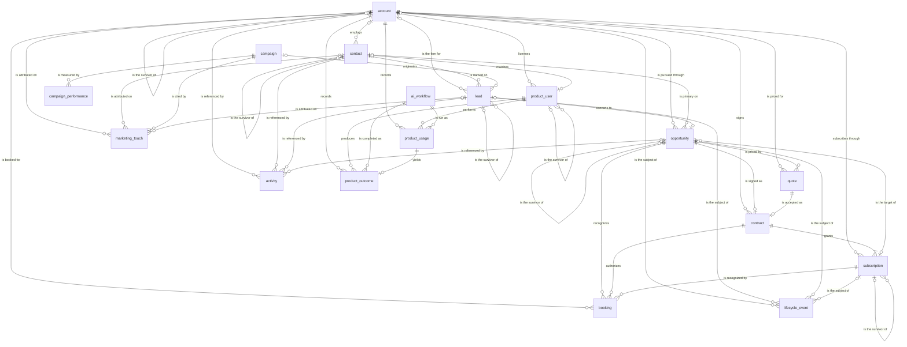

# Canonical GTM entity relationships

This diagram is the canonical go-to-market model for a fictional AI-native B2B SaaS company that sells to plaintiff law firms. It contains canonical entities only. Source tables, source identifiers, and attribute ownership are in `source-mapping.md`. Business definitions, grains, and keys are in `entities.md`. History, identity, and the logical source schema are in `decisions.md`.

The marker beside an entity is how many of that entity participate in the relationship. `||` is exactly one, `|o` is zero or one, `}o` is zero or many, and `}|` is one or many.

A customer is the law-firm account after the first won opportunity. Customer is a lifecycle stage and a commercial status of `account`, so the diagram has no separate customer entity. In each survivor self-relationship, zero or one is the surviving row and zero or many is the duplicate row. The duplicate holds `surviving_<entity>_id`.

## Diagram

## Cardinality

An account has zero or many contacts. A contact belongs to zero or one account.

An account has zero or many leads. A lead belongs to zero or one account.

An account has zero or many opportunities. An opportunity belongs to exactly one account.

An account has zero or many quotes. A quote belongs to exactly one account.

An account has zero or many contracts. A contract belongs to exactly one account.

An account has zero or many subscriptions. A subscription belongs to exactly one account.

An account has zero or many bookings. A booking belongs to exactly one account.

An account has zero or many activities. An activity belongs to zero or one account.

An account has zero or many marketing touches. A marketing touch belongs to zero or one account.

An account has zero or many product users. A product user belongs to exactly one account.

An account has zero or many product usage events. A product usage event belongs to exactly one account.

An account has zero or many product outcomes. A product outcome belongs to exactly one account.

An account has zero or many lifecycle events. A lifecycle event belongs to zero or one account.

A duplicate account identifies zero or one surviving account. A surviving account is identified by zero or many duplicate accounts.

A contact has zero or many leads. A lead names zero or one contact.

A contact is the primary contact of zero or many opportunities. An opportunity has zero or one primary contact.

A contact has zero or many activities. An activity belongs to zero or one contact.

A contact has zero or many marketing touches. A marketing touch belongs to zero or one contact.

A contact matches zero or one product user. A product user matches zero or one contact.

A duplicate contact identifies zero or one surviving contact. A surviving contact is identified by zero or many duplicate contacts.

A campaign originates zero or many leads. A lead has zero or one originating campaign.

A campaign has zero or many campaign performance rows. A campaign performance row belongs to exactly one campaign.

A campaign has zero or many marketing touches. A marketing touch belongs to exactly one campaign.

A lead converts to zero or one opportunity. An opportunity comes from zero or one lead.

A lead has zero or many activities. An activity belongs to zero or one lead.

A lead has zero or many marketing touches. A marketing touch belongs to zero or one lead.

A lead has zero or many lifecycle events. A lifecycle event belongs to zero or one lead.

A duplicate lead identifies zero or one surviving lead. A surviving lead is identified by zero or many duplicate leads.

A subscription is the target of zero or many opportunities. An opportunity targets zero or one subscription.

An opportunity has zero or many quotes. A quote belongs to exactly one opportunity.

An opportunity has zero or one contract. A contract belongs to exactly one opportunity.

An opportunity has zero or many bookings. A booking belongs to exactly one opportunity.

An opportunity has zero or many activities. An activity belongs to zero or one opportunity.

An opportunity has zero or many lifecycle events. A lifecycle event belongs to zero or one opportunity.

A duplicate opportunity identifies zero or one surviving opportunity. A surviving opportunity is identified by zero or many duplicate opportunities.

A quote is accepted as zero or one contract. A contract belongs to exactly one quote.

A contract grants one or many subscriptions. A subscription belongs to exactly one contract.

A contract authorizes zero or many bookings. A booking belongs to exactly one contract.

A subscription has zero or many bookings. A booking belongs to exactly one subscription.

A subscription has zero or many lifecycle events. A lifecycle event belongs to zero or one subscription.

A duplicate subscription identifies zero or one surviving subscription. A surviving subscription is identified by zero or many duplicate subscriptions.

A product user performs zero or many product usage events. A product usage event belongs to exactly one product user.

A product user produces zero or many product outcomes. A product outcome belongs to exactly one product user.

A duplicate product user identifies zero or one surviving product user. A surviving product user is identified by zero or many duplicate product users.

An AI workflow is run as zero or many product usage events. A product usage event belongs to exactly one AI workflow.

An AI workflow is completed as zero or many product outcomes. A product outcome belongs to exactly one AI workflow.

A product usage event yields zero or one product outcome. A product outcome belongs to exactly one product usage event.

An activity belongs to at least one of account, contact, lead, or opportunity. A marketing touch belongs to exactly one campaign and to at least one of account, contact, or lead. The foreign keys that each lifecycle event requires are listed on `lifecycle_event` in `entities.md`.

## Keys

Every primary key is a surrogate. The reason for each surrogate, and the business key where one exists, is in `entities.md`. Every foreign key below references the primary key of the named entity.

| Entity | Primary key | Foreign keys |
|---|---|---|
| account | `account_id` | `surviving_account_id` → `account.account_id` |
| contact | `contact_id` | `account_id` → `account.account_id`; `surviving_contact_id` → `contact.contact_id` |
| lead | `lead_id` | `account_id` → `account.account_id`; `contact_id` → `contact.contact_id`; `originating_campaign_id` → `campaign.campaign_id`; `surviving_lead_id` → `lead.lead_id` |
| opportunity | `opportunity_id` | `account_id` → `account.account_id`; `primary_contact_id` → `contact.contact_id`; `lead_id` → `lead.lead_id`; `subscription_id` → `subscription.subscription_id`; `surviving_opportunity_id` → `opportunity.opportunity_id` |
| quote | `quote_id` | `account_id` → `account.account_id`; `opportunity_id` → `opportunity.opportunity_id` |
| contract | `contract_id` | `account_id` → `account.account_id`; `opportunity_id` → `opportunity.opportunity_id`; `quote_id` → `quote.quote_id` |
| subscription | `subscription_id` | `account_id` → `account.account_id`; `contract_id` → `contract.contract_id`; `surviving_subscription_id` → `subscription.subscription_id` |
| booking | `booking_id` | `account_id` → `account.account_id`; `opportunity_id` → `opportunity.opportunity_id`; `contract_id` → `contract.contract_id`; `subscription_id` → `subscription.subscription_id` |
| campaign | `campaign_id` | none |
| campaign_performance | `campaign_performance_id` | `campaign_id` → `campaign.campaign_id` |
| marketing_touch | `marketing_touch_id` | `campaign_id` → `campaign.campaign_id`; `account_id` → `account.account_id`; `contact_id` → `contact.contact_id`; `lead_id` → `lead.lead_id` |
| activity | `activity_id` | `account_id` → `account.account_id`; `contact_id` → `contact.contact_id`; `lead_id` → `lead.lead_id`; `opportunity_id` → `opportunity.opportunity_id` |
| product_user | `product_user_id` | `account_id` → `account.account_id`; `contact_id` → `contact.contact_id`; `surviving_product_user_id` → `product_user.product_user_id` |
| ai_workflow | `ai_workflow_id` | none |
| product_usage | `product_usage_id` | `account_id` → `account.account_id`; `product_user_id` → `product_user.product_user_id`; `ai_workflow_id` → `ai_workflow.ai_workflow_id` |
| product_outcome | `product_outcome_id` | `product_usage_id` → `product_usage.product_usage_id`; `account_id` → `account.account_id`; `product_user_id` → `product_user.product_user_id`; `ai_workflow_id` → `ai_workflow.ai_workflow_id` |
| lifecycle_event | `lifecycle_event_id` | `account_id` → `account.account_id`; `lead_id` → `lead.lead_id`; `opportunity_id` → `opportunity.opportunity_id`; `subscription_id` → `subscription.subscription_id` |

## Lifecycle walkthrough

The path from lead to renewal crosses five canonical stages. A campaign can originate a lead. That lead names zero or one contact and belongs to zero or one account while it is still an inquiry. Lead creation, qualification, disqualification, and conversion are lifecycle events on the lead. Conversion connects the lead to one opportunity, and that opportunity belongs to exactly one account. Sales works the opportunity through open stages, with zero or many quotes. A won new-business opportunity is signed as one contract. The contract accepts one quote and grants one or many subscriptions. Bookings then recognize the commercial result for that account, opportunity, contract, and subscription.

Customer conversion is the account's first won opportunity. The customer is that account: `commercial_status` becomes `customer`, and the canonical identifier remains `account_id`. The lead keeps its own `lead_id`. Product users of the account use AI workflows. Each use is a product usage event, and each completed use can yield one product outcome. The account's first product outcome is the adoption event, so adoption sits on the same account that became the customer.

Renewal and expansion are later opportunities that target the existing subscription. Each one can recognize a booking and change the subscription's term or recurring amount. Churn is a lifecycle event on that subscription. The account stays the customer through adoption and renewal; those stages are recorded on events, while the account keeps a single commercial status. A renewal extends the existing contract and subscription. It does not create a second customer.
